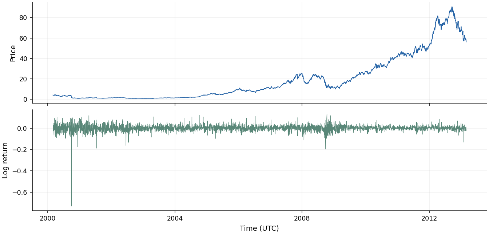
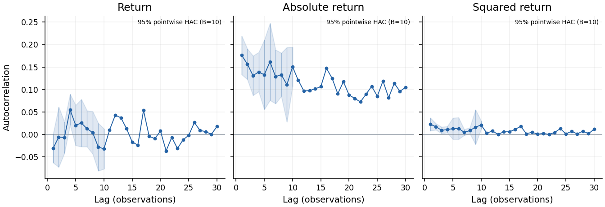

# Financial Stylized Facts

**从市场价格与成交量生成金融典型事实的图文报告。**

面向股票、外汇及其他金融时间序列，覆盖 [Cont (2001)](https://doi.org/10.1080/713665670) 总结的 11 项 stylized facts。输入 CSV，即可得到独立 HTML 报告、统计表和可复核的计算结果，可用于真实市场研究及市场模拟器评估。

- **逐资产、逐路径分析**：分别展示收益分布、波动聚集、自相关和多尺度变化。
- **报告与数值一起输出**：图表配有根据计算结果生成的说明；HTML 离线可读，JSON、CSV 和 PNG 可继续用于研究。
- **不确定性估计**：提供区块重采样与 HAC 近似区间。
- **本地运行**：分析和报告生成无需大模型、API 密钥或在线服务。

## 真实数据示例

仓库包含真实历史数据、生成脚本和配套报告，克隆后即可运行。

| 数据 | 覆盖时间 | 来源 | 报告 |
| --- | --- | --- | --- |
| AAPL、MSFT 日频股票 | 2000–2013 | Quandl WIKI，经 Bokeh 数据集分发 | [AAPL](examples/reports/AAPL.html) · [MSFT](examples/reports/MSFT.html) |
| EUR/USD、USD/JPY 日频汇率 | 2010–2025 | Federal Reserve H.10 | [EUR/USD](examples/reports/EURUSD.html) · [USD/JPY](examples/reports/USDJPY.html) |

**AAPL：价格、收益与波动聚集**





## 安装与运行

```bash
git clone https://github.com/dingv/financial-stylized-facts.git
cd financial-stylized-facts
conda env create -f environment.yml
conda activate financial-stylized-facts
python -m pip install --no-deps --no-build-isolation -e .

python examples/run_reports.py --dataset AAPL --output /tmp/fsf-aapl
```

打开 `/tmp/fsf-aapl/AAPL/report/index.html`。用 `--dataset all` 为四组真实数据分别生成报告。

分析自己的分钟价格：

```bash
fsf analyze prices.csv --output /tmp/my-report \
  --frequency 5min --timezone Asia/Shanghai \
  --max-staleness 30s --price-type transaction
```

CSV 包含 `timestamp,price`，可选 `asset_id,path_id,session_id,volume`。完整参数见[使用指南](docs/usage.md)。

Python 接口：

```python
from financial_stylized_facts import AnalysisConfig, analyze_csv

result = analyze_csv(
    "prices.csv", "/tmp/my-report",
    AnalysisConfig(frequency="5min", timezone="Asia/Shanghai",
                   max_staleness="30s", price_type="transaction"),
)
```

## 分析内容

| Stylized fact | 报告中的分析 |
| --- | --- |
| 收益线性相关较弱 | 收益 ACF |
| 厚尾 | 收益密度、超额峰度、经验尾概率与 Q-Q |
| 涨跌不对称 | 左右尾、偏度、对称阈值首达时间 |
| 聚合高斯化 | 不同时间尺度的峰度与分位数距离 |
| 间歇性 | 滚动 RMS 与大幅波动片段 |
| 波动聚集 | 绝对收益、平方收益 ACF |
| 条件厚尾 | GARCH 调整前后的分布与残余相关 |
| 波动相关缓慢衰减 | 长范围 ACF、分段对照与 Lo 修正 R/S |
| 杠杆效应 | 收益与前后波动的相关 |
| 成交量与波动相关 | Pearson、Spearman 与分组图 |
| 时间尺度不对称 | 粗、细尺度波动的两个时间方向对照 |

## 文档

- [使用指南](docs/usage.md)：CSV 输入、命令行与报告阅读。
- [数据指南](docs/data-guide.md)：股票、FRED、EBS 数据接入。
- [统计方法](docs/methods.md)：指标与计算方法。
- [参考文献](docs/references.md)：方法来源与数值计算参考。

## 参考文献

1. Cont, R. (2001). [Empirical properties of asset returns: stylized facts and statistical issues](https://doi.org/10.1080/713665670). *Quantitative Finance*, 1(2), 223–236.
2. Ratliff-Crain, E., et al. (2025). [Revisiting Cont’s stylized facts for modern stock markets](https://doi.org/10.1080/14697688.2025.2530637). *Quantitative Finance*, 25(9), 1343–1373.
3. Newey, W. K., & West, K. D. (1987). [A Simple, Positive Semi-Definite, Heteroskedasticity and Autocorrelation Consistent Covariance Matrix](https://doi.org/10.2307/1913610). *Econometrica*.
4. Lo, A. W. (1991). [Long-Term Memory in Stock Market Prices](https://doi.org/10.2307/2938368). *Econometrica*.
5. Jensen, M. H., Johansen, A., & Simonsen, I. (2003). [Inverse statistics in economics: The gain–loss asymmetry](https://doi.org/10.1016/S0378-4371%2802%2901884-8). *Physica A*.
